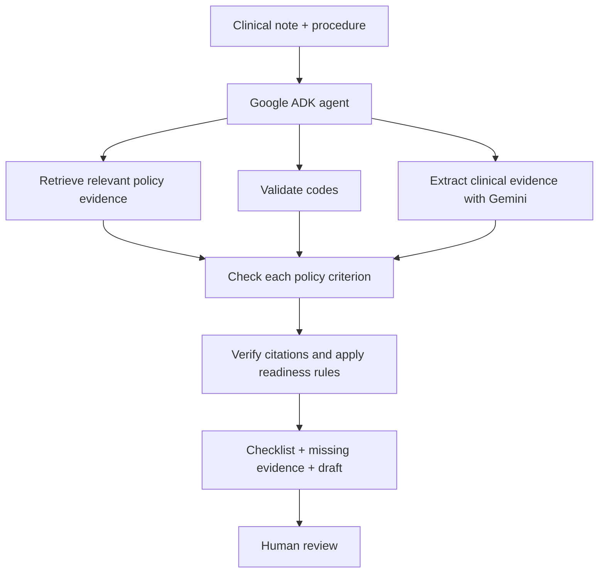

# Agentic RAG System for Healthcare Prior Authorization

**An Agentic RAG system that checks clinical documentation against prior authorization requirements, highlights missing evidence, and prepares a citation-grounded draft for human review.**

Built with **Python, Google ADK, Gemini, Vertex AI, BigQuery, FastAPI, and Streamlit**.

## Overview

**Prior authorization** is a process in which a health insurer reviews a request for certain medical services or medications before they are provided to determine whether they meet the insurer's coverage requirements. For example, a clinic may need to submit records explaining why a patient needs an MRI, a knee procedure, or a biologic medication.

Before submitting that request, healthcare staff must read the insurer's policy, check the medical requirements against a clinical note, and identify supporting evidence. Missing information can lead to rework or delays.

**PriorAuth Agent checks the documentation before submission.** In this project, it reviews three scenarios: **lumbar spine MRI, selected knee procedures, and infliximab treatment for Crohn's disease**. It helps staff see which policy requirements have supporting documentation and which need attention.

I built **PriorAuth Agent** to make that process easier to review. It retrieves relevant policy sections, checks each requirement against the clinical note, identifies gaps or uncertain evidence, and prepares a draft supported by citations. The final readiness decision follows explicit rules rather than relying solely on the language model.

**The system does not approve, deny, or submit requests.** It produces a documentation-readiness assessment for a person to review.

## How it works



The workflow combines **LLM-based evidence interpretation** with **deterministic safeguards**:

- **Policy retrieval:** Finds relevant policy sections using Vertex AI embeddings and BigQuery vector search.
- **Evidence matching:** Uses Gemini to assess whether the clinical note supports each policy criterion, with exact note excerpts.
- **Code and citation checks:** Validates codes and checks that quoted note text is actually present.
- **Readiness scoring:** Applies explicit policy pathways and exclusions to produce `READY_FOR_HUMAN_REVIEW`, `NOT_READY`, or `NEEDS_MANUAL_REVIEW`.
- **Draft and audit trail:** Prepares a draft using verified claims and records the review steps.

A verbatim quote check does **not** prove that the quote logically supports a criterion. That is a known limitation discussed in the evaluation.

## Results

I evaluated the system on **30 annotated cases across three procedures**, using a real Gemini/Vertex AI pipeline. Most cases were structured test fixtures; three were adapted from published case reports. Results describe this small evaluation set, **not performance in real clinical practice**.

| Metric | PriorAuth Agent | Simple RAG baseline |
|---|---:|---:|
| Criterion-level accuracy | 171/200 (**85.5%**) | 176/200 (**88.0%**) |
| Case-readiness accuracy | 28/30 (**93.3%**) | 8/30 (**26.7%**) |
| False-ready decisions | **0/25** | 18/25 |
| Missing-evidence recall | 12/14 | 13/14 |
| Median latency per case | 28.8 s | 10.9 s |
| Estimated model cost, 30 cases | $0.0784 | $0.0463 |

**What the comparison shows:** The simpler RAG baseline was slightly better at classifying individual criteria. The full system was much better at making the final *documentation-readiness* assessment on this dataset, largely because it applies explicit pathways, exclusions, and safeguard rules. This is the main result of the project—not a claim that more agents automatically improve language-model accuracy.

A no-citation-verifier run achieved **173/200 criterion accuracy and 28/30 case-readiness accuracy**. Citation verification did **not** demonstrate an accuracy improvement in this experiment.

The evaluation also exposed real errors. For example, the model inferred a knee imaging grade that was not documented and confused evidence of untreated latent TB with documentation of a screening step. Neither case was marked ready overall, but both showed why exact quotations alone are insufficient to verify clinical reasoning.

See [`docs/EVAL_RESULTS_2026-10-27.md`](docs/EVAL_RESULTS_2026-10-27.md), [`docs/FAILURE_ANALYSIS_2026-10-27.md`](docs/FAILURE_ANALYSIS_2026-10-27.md), and [`evidence/cloud_eval_2026-10-27/raw/`](evidence/cloud_eval_2026-10-27/raw/) for the detailed results and original output files.

## Technologies

| Area | Tools |
|---|---|
| Agent workflow | Google ADK, `Runner.run_async`, function tools |
| Language model | Gemini via Vertex AI |
| Retrieval | Vertex AI `text-embedding-004`, BigQuery `VECTOR_SEARCH` |
| Backend and UI | Python, FastAPI, Streamlit, Pydantic |
| Data and cloud | BigQuery, Google Cloud Storage configuration |
| Testing | pytest, evaluation scripts, baseline and ablation comparisons |

## Data and scope

The prototype checks whether documentation supports the policy requirements for these three types of prior authorization requests:

| Procedure | Policy reference |
|---|---|
| MRI of the lower back (lumbar spine) | Aetna CPB 0236 |
| Selected knee procedures or treatments (including the modeled arthroscopy scenario) | Aetna CPB 0673 |
| Infliximab, a biologic treatment for Crohn's disease | Cigna IP0660 |

The implemented policies are **simplified subsets**, not complete reproductions or comprehensive interpretations of payer requirements. The Cigna policy was not fully reviewed. The 30-case evaluation includes **27 constructed test cases and three cases adapted from published reports**, with no real patient identifiers or PHI. See [`docs/DATA_PROVENANCE.md`](docs/DATA_PROVENANCE.md) for sources and restrictions.

## Run locally

Requires Python 3.12. The commands below use a bash-style terminal; on Windows PowerShell, activate the virtual environment with `.venv\Scripts\Activate.ps1` and set `PYTHONPATH` appropriately.

```bash
python -m venv .venv
source .venv/bin/activate
pip install -r requirements.txt
PYTHONPATH=src pytest tests/ -q
```

The reported local verification was **49 tests passed, 1 skipped**. The end-to-end review requires authenticated GCP access and will return an error without it; there are no mock model responses substituted for a live review.

Start the API:

```bash
PYTHONPATH=src uvicorn priorauth.api:app --port 8000
```

The Streamlit UI is in [`app/`](app/). See [`docs/CONFIGURATION.md`](docs/CONFIGURATION.md) for required environment variables and [`docs/DEPLOYMENT.md`](docs/DEPLOYMENT.md) for deployment instructions.

The original evaluation used `gemini-3.5-flash` at `global` with data in `us-central1` and `text-embedding-004` (768 dimensions). **Model and location must be set explicitly** and re-verified before a new cloud run. Cloud services may incur charges.

To recompute the stored evaluation results without calling the model:

```bash
PYTHONPATH=src python scripts/recompute_metrics.py evidence/cloud_eval_2026-10-27/raw/
```

The script verifies the current full-system, ablation, and corrected-baseline metrics. It also flags a known token-accounting mismatch in the *superseded* original baseline, so the overall process exits with code 1 rather than hiding that historical discrepancy.

## Project structure

```text
src/priorauth/    Agent, tools, retrieval, scoring, API
app/              Streamlit interface
data/             Simplified policies and evaluation cases
scripts/          Evaluation and metric verification
tests/            Automated tests
evidence/         Original cloud evaluation outputs
gcp/              Schemas, deployment and setup scripts
docs/             Architecture, data sources, evaluation and limitations
```

## Limitations and next steps

- **Not deployed live:** Cloud Run deployment was blocked by Cloud Build service-account permissions. Deployment files are included, but there is no live URL or hosted demo.
- **Not for clinical use:** Policies are simplified and the case set is small; the system has not been clinically validated. Human review is always required.
- **Citation verification is limited:** It checks verbatim evidence presence, not whether the quoted text semantically proves a criterion.
- **Cloud costs are not fully attributable:** Script-estimated model costs and delayed console billing deltas differed; see the evaluation and cost documentation.

Future improvements would include complete policy coverage, a semantic evidence verifier, evaluation on a larger independently annotated set, and a properly authorized live deployment.

## License

MIT. See [`LICENSE`](LICENSE). Source-policy and published-case materials may have their own usage restrictions, as described in the data provenance documentation.
