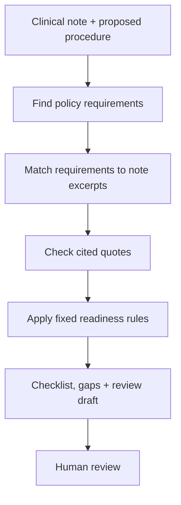

# PriorAuth Agent | Agentic RAG System for Healthcare Prior Authorization

> On 30 mostly synthetic test cases, PriorAuth Agent marked **0 of 25 cases that should not be ready** as ready. A simpler RAG baseline marked **18 of 25** as ready.

[**Project presentation**](https://docs.google.com/presentation/d/1hSZwBwVptMJP8Zur1osZBa4NppOKYYfIrKm4_gLmY-A/edit?usp=sharing) · [Evaluation details](docs/EVAL_RESULTS_2026-10-27.md) · [Architecture](docs/architecture.md)

## The problem

Before a clinic can schedule certain tests or treatments, a patient's health insurer may require prior authorization: documentation showing that the planned care meets the insurer's coverage rules. For example, a clinic might need to show why a lower-back MRI is needed or what previous treatments a patient has tried before starting a medication.

Someone on the clinic team has to read the policy, look through the clinical note, and check that the evidence is actually there. If a required detail is missing, staff may have to gather more documentation, resubmit a request, or deal with delays that affect the patient.

## What PriorAuth Agent does

It retrieves the relevant policy requirements, checks a clinical note against each one, and produces a checklist with supporting quotes, missing information, and a draft for staff to review. It uses AI to interpret the note but applies fixed rules to decide whether the documentation is ready for human review.

It does not approve, deny, or submit insurance authorizations. A person remains responsible for reviewing the full policy and deciding what to submit.

## Data and scope

The evaluation includes 30 clinical cases: 27 constructed test cases and 3 adapted from published case reports. No real patient records or protected health information were used. Real clinical notes are sensitive and usually require appropriate access, permissions, and privacy safeguards, so this project uses controlled examples to test the workflow.

The prototype covers selected documentation requirements for:

| Review scenario | Policy reference |
| --- | --- |
| Lumbar spine MRI (lower-back imaging) | [Aetna CPB 0236](https://www.aetna.com/cpb/medical/data/200_299/0236.html) |
| Knee osteoarthritis treatment review using selected policy requirements | [Aetna CPB 0673](https://www.aetna.com/cpb/medical/data/600_699/0673.html) |
| Intravenous infliximab treatment for Crohn's disease | [Cigna IP0660](docs/DATA_PROVENANCE.md) |

This project uses selected requirements from real insurance policies, not complete policies. I did not review all 22 pages of Cigna IP0660 in detail, so the Crohn's-related subset cannot be used for real coverage decisions. See [Data Provenance](docs/DATA_PROVENANCE.md) for sources and usage notes.

## How it works

1. **Find the policy.** Retrieve the relevant policy sections for the selected procedure.
2. **Check the note.** Match each requirement to evidence in the clinical note, including exact supporting excerpts or gaps.
3. **Check the quotes.** Verify that cited note excerpts actually appear in the note. This is a text check, not proof that an excerpt supports the medical conclusion.
4. **Apply the rules.** Use explicit pathways, exclusions, and uncertainty rules to assign `READY_FOR_HUMAN_REVIEW`, `NOT_READY`, or `NEEDS_MANUAL_REVIEW`.

The language model can misunderstand a note. In a healthcare workflow, the final readiness status should not depend on the model simply guessing that everything is complete.



Built with Python, Google ADK (agent orchestration), RAG (retrieving supporting text before generating an answer), Gemini on Vertex AI, BigQuery vector search, FastAPI, and Streamlit. See the [architecture](docs/architecture.md) and [ADK integration](docs/ADK_INTEGRATION.md) for implementation details.

## Results

*These results come from 30 mostly synthetic, annotated cases using simplified policy requirements, not clinical validation. The original baseline prompt omitted the policy criteria list and expected status labels, making its 7% criterion accuracy misleading. Adding those details raised its score to 88% on the same cases, making the comparison more demanding for PriorAuth Agent; the corrected results are used below.*

| Metric | PriorAuth Agent | Corrected simple RAG baseline |
| --- | ---: | ---: |
| Case-readiness accuracy | **28/30 (93.3%)** | 8/30 (26.7%) |
| False-ready decisions | **0/25** | 18/25 |
| Individual criterion accuracy | 171/200 (85.5%) | 176/200 (88.0%) |
| Missing-evidence recall | 12/14 (85.7%) | 13/14 (92.9%) |
| Median time per case | 28.8 sec | 10.9 sec |
| Estimated model cost, all 30 cases | $0.0784 | $0.0463 |

The 25 are the cases whose gold labels were *not* ready for submission review. A false-ready decision incorrectly marks one of them ready, potentially allowing a weak request to go forward and cause rework, delay, or denial.

The simpler RAG baseline was slightly better on individual requirements (88.0% versus 85.5%): a difference of five judgments on a small dataset. The main advantage of PriorAuth Agent here was the final readiness decision, where explicit rules kept it from marking any of those 25 cases ready.

Of 14 genuinely missing pieces of evidence, the full system flagged 12 rather than incorrectly treating them as met. Two of its 30 final readiness decisions were wrong: both cases should have been sent for manual review but were marked `NOT_READY`. Neither was a false-ready decision; both were more cautious than the gold label.

PriorAuth Agent got more final readiness decisions right on this test set, but took longer per case (28.8 seconds compared with 10.9 seconds for simple RAG). 

Citation verification did not show a meaningful accuracy gain on this small test set (171/200 criteria with it versus 173/200 without it). Checking that a quote exists is not enough to confirm the AI interpreted it correctly.

Detailed results and raw predictions: [Evaluation report](docs/EVAL_RESULTS_2026-10-27.md) · [Failure analysis](docs/FAILURE_ANALYSIS_2026-10-27.md) · [Raw evidence](evidence/cloud_eval_2026-10-27/raw/).

## What I learned

The evaluation highlighted two mistakes:

- **Knee imaging:** The AI assumed an imaging grade that was not documented in the clinical note.
- **Infliximab screening:** The AI confused untreated latent tuberculosis (TB) with evidence that TB screening had been completed.

The AI found relevant excerpts but interpreted them incorrectly. Both cases still ended up marked not ready because of other requirements or exclusions.

## Limitations and next steps

- The test set is small: 30 mostly synthetic cases. 
- The policies cover only selected requirements, not full, current insurer policies.
- The quote checker cannot reliably tell whether an excerpt actually supports the AI's interpretation.
- The AI workflow ran on GCP, but public Cloud Run deployment was blocked by service-account permissions. 

Next steps: test independently written and labeled cases, add a semantic evidence verifier that checks whether quotes really support each conclusion and measure it on those cases, and complete a secure live deployment.

## Run the project

Requires Python 3.12. From the project root, in a bash-style terminal:

```bash
python3 -m venv .venv
source .venv/bin/activate
pip install -r requirements.txt
PYTHONPATH=src pytest tests/ -q
```

The reported clean-environment test result is **49 passed, 1 skipped**. A live review requires GCP credentials and the explicitly configured model; without them, the API returns an error rather than a simulated answer.

```bash
PYTHONPATH=src uvicorn priorauth.api:app --port 8000
```

For cloud configuration and deployment requirements, see [Configuration](docs/CONFIGURATION.md) and [Deployment](docs/DEPLOYMENT.md). To recompute reported metrics from the included evaluation files, use `scripts/recompute_metrics.py` (see [raw verification notes](docs/RAW_VERIFICATION_AND_RECOMPUTATION_2026-10-27.md)).

---
